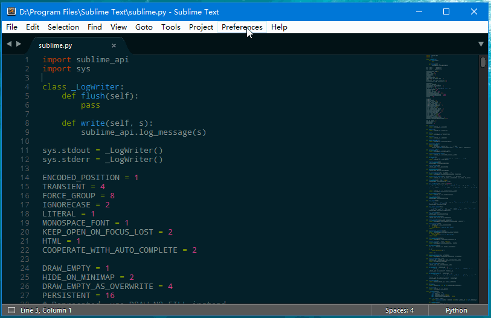
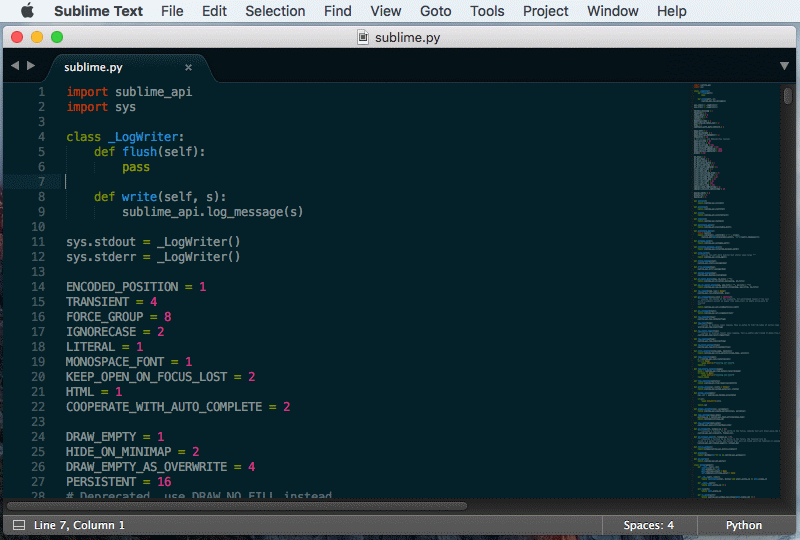
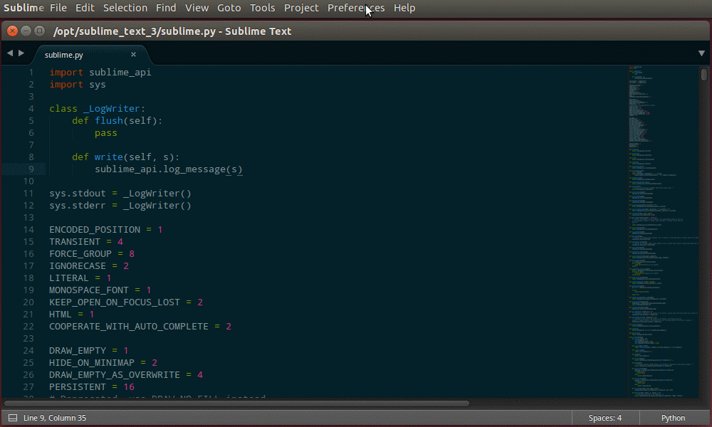

# LocalizedMenu

Narzędzie do tłumaczenia menu dla użytkowników Sublime Text 2/3/4.

- Ułatwia dodawanie nowych języków.
- Obsługuje różne wersje programu i systemy operacyjne.
- Pozwala korzystać ze wspólnych menu.
- Automatycznie tworzy kopie zapasowe lokalnych menu.
- Automatycznie wypakowuje angielskie menu dla nowych wersji programu.

# README.md

- de_DE [Deutsch](README.de_DE.md)
- en [English](../README.md)
- es_ES [Español](README.es_ES.md)
- fr_FR [Français](README.fr_FR.md)
- hu [Magyar](README.hu.md)
- pl_PL [Polski](README.pl_PL.md)
- hy [Հայերեն](README.hy.md)
- pt_BR [Português do Brasil](README.pt_BR.md)
- ru [Русский](README.ru.md)
- sv_SE [Svenska](README.sv_SE.md)
- zh_CN [简体中文](README.zh_CN.md)
- zh_TW [繁體中文](README.zh_TW.md)

# Projekt jest dostępny także na

- [GitHub](https://github.com/zam1024t/LocalizedMenu)
- [Gitee](https://gitee.com/zam1024t/LocalizedMenu)

# Zrzuty ekranu

#### Windows


#### OS X


#### Ubuntu


# Instalacja

- Za pomocą Package Control:
  - Zainstaluj [Package Control](https://packagecontrol.io/installation).
  - Wyszukaj i zainstaluj `LocalizedMenu`.
- Ręcznie:
  - Pobierz [master.zip](https://github.com/zam1024t/LocalizedMenu/archive/master.zip), wypakuj go do folderu `Packages` i zmień nazwę folderu `LocalizedMenu-master` na `LocalizedMenu`.
  - Możesz też sklonować repozytorium do folderu `Packages`:

    ```
    git clone https://github.com/zam1024t/LocalizedMenu
    ```

# Używanie

- Zmiana języka w menu:
  - Wybierz `Preferences` → `Languages`.
- Zmiana języka z palety poleceń:
  - Naciśnij `Ctrl+Shift+P` i wpisz `lmxx`, gdzie *xx* to kod języka.

# Dodawanie języka

- Skopiuj `locale/en/en.json` do `locale/<locale>/<locale>.json` i przetłumacz plik na swój język.
- Skopiuj `menu/<version>/en/*` do `menu/<version>/<locale>/*` i przetłumacz pliki na swój język.
- Na przykład, aby dodać język o kodzie `my` dla Sublime Text build 3999:
  - Otwórz folder `LocalizedMenu` przez `Preferences` → `Languages` → `Add a language`.
  - Wejdź do folderu `locale` i skopiuj folder `en` pod nazwą `my`.
  - Wejdź do folderu `my`, zmień nazwę `en.json` na `my.json` i edytuj go:

    ```json
    {
        "link": "",
        "hidden": false,
        "caption": "MyLanguage",
        "mnemonic": "M"
    }
    ```

  - Wejdź do folderu `menu/3999`, skopiuj folder `en` pod nazwą `my` i przetłumacz wszystkie wartości `caption` w plikach menu.
  - Wybierz `Preferences` → `Languages` → `Detect`, aby wykryć nowy język. Na liście pojawi się `MyLanguage (my)`.

  > **Ustawienia języka**<br>
  > `link`: kod języka, do którego prowadzi odnośnik<br>
  > `hidden`: ukrywa pozycję w menu<br>
  > `caption`: nazwa języka; kod zostanie dodany automatycznie<br>
  > `mnemonic`: litera dostępu w menu; opcjonalna. Musi występować w `caption` z zachowaniem wielkości liter.

# Zgłaszanie języka

- Nazwij język według wzoru `<languageCode>` lub `<languageCode>_<countryCode>`.
  - `<languageCode>` zapisz małymi literami, a `<countryCode>` wielkimi. Jeśli używasz tłumaczenia tylko lokalnie, możesz pominąć tę zasadę.
  - Kody języków: https://www.wikipedia.org/wiki/ISO_639-1
  - Kody krajów: https://www.wikipedia.org/wiki/ISO_3166-1
- Utwórz własną kopię repozytorium (fork).
- Wyślij zgłoszenie zmian (pull request).

# Języki i autorzy

- de_DE Deutsch — [Standarduser](https://github.com/Standarduser)
- es Español — [Christopher](https://t.me/Azriel_7589)
- es_ES Español — [Dastillero](https://github.com/dap39)
- fr_FR Français — [fxbenard](https://github.com/fxbenard)
- hu Magyar — [Tamás Balog](https://github.com/picimako)
- hy Հայերեն — [Arman High Foundation](https://github.com/ArmanHigh)
- pl_PL Polski — [1teacherr1](https://github.com/1teacherr1)
- pt Português do Brasil — [JNylson](https://github.com/jnylson)
- ru Русский — [Dimox](http://dimox.name), [Ant0sh](https://github.com/Ant0sh) i [Maksim Arhipov](https://github.com/OSPanel)
- sv_SE Svenska — [H2SO4JB](https://github.com/H2SO4JB)
- zh_CN 简体中文 — [Zam](https://github.com/zam1024t)
- zh_TW 繁體中文 — [Zam](https://github.com/zam1024t)

# Powiązane dyskusje

- https://github.com/wbond/package_control_channel/pull/5665
- https://github.com/rexdf/ChineseLocalization/issues/10

# Licencja

[Licencja MIT](../LICENSE)
